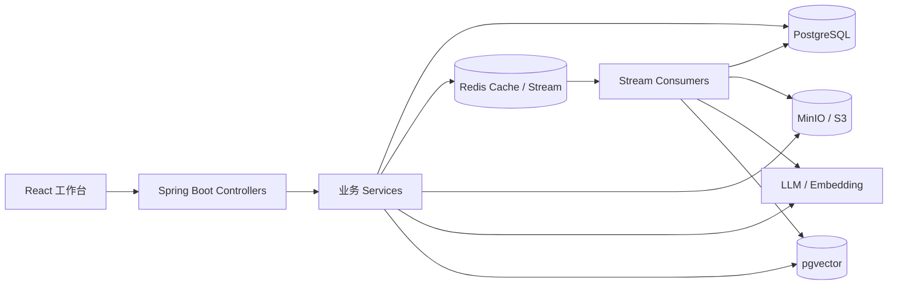
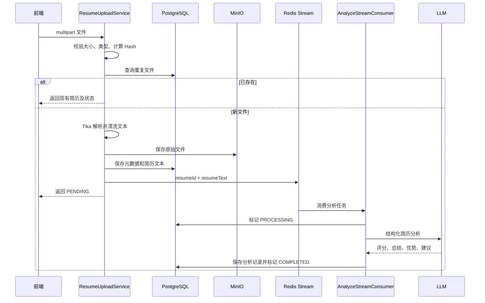
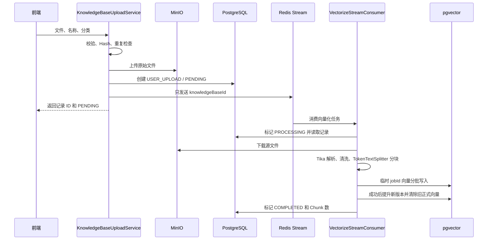
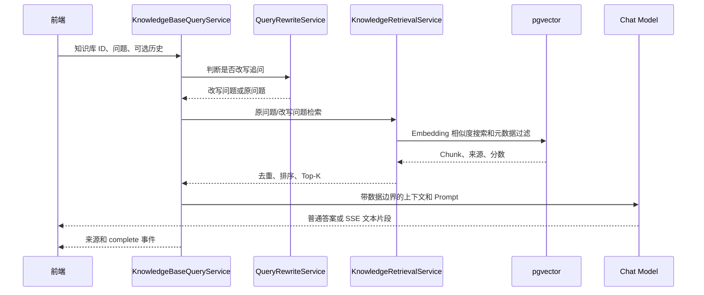
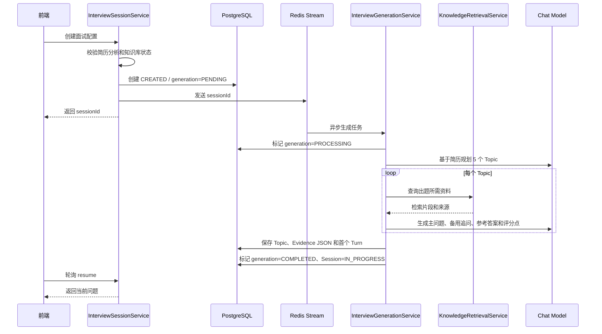

# 功能实现流程与设计亮点

本文从用户操作开始，说明请求经过前端、后端服务、数据库、对象存储、向量库和 Redis Stream 的过程。数据库字段明细另见 [数据库实体与表结构.md](数据库实体表结构.md)，技术栈和开发环境另见 [项目技术选型与功能实现总结.md](项目技术选型与功能实现总结.md)。

## 一、应用整体结构



Controller 接收请求并委托 Service。短事务负责状态和结果持久化；文件解析、对象存储、Embedding 和 LLM 调用放在事务之外。Redis 用于异步任务和面试会话热缓存，PostgreSQL 保存可恢复的业务事实。

## 二、简历上传与分析

用户在 `/resumes` 选择简历，前端调用 `POST /api/resumes/upload`。主要步骤如下：



前端通过简历列表中的 `analyzeStatus` 轮询状态；完成后进入详情页，读取简历文本和最新分析记录。失败时显示错误并允许重新分析。删除时先删除数据库简历和分析记录，再尝试删除 MinIO 对象。

设计要点：重复检测依据文件内容 Hash，而不是文件名；AI 分析异步执行，上传响应不等待模型；分析记录独立保存，因此重新分析可以保留历史结果。

需要留意：对象存储、数据库和 Stream 不是一个原子事务。任务入队失败会尽量将简历标为 FAILED，但对象上传成功而数据库保存失败时仍需关注孤立对象清理。

## 三、知识库上传、内置资料与向量化

知识库管理页支持用户上传文档，也展示系统内置 Markdown。用户上传的处理顺序如下：



内置资料由 `BuiltInKnowledgeBootstrapService` 在应用启动后扫描 `classpath:skills/**/*.md`，用稳定 `sourceKey` 查记录、用内容 Hash 判断是否变化。内容未变化则跳过；新资料或 Hash 变化才创建/更新记录并排队向量化。内置知识库不能物理删除，管理接口通过 `enabled=false` 禁用。

重新向量化采用临时版本：先写新向量，所有 Chunk 成功后才切换正式版本。这样中途失败时旧向量仍可检索。Topic 的 Evidence 快照会保留当时使用的来源信息和内容。

## 四、知识库检索与 RAG 问答

知识库问答页选择已完成且启用的知识库，输入问题后调用普通问答或 SSE 接口。



检索会限制在用户选中的知识库及可用状态内，并返回来源名称、类型、类别、版本、Chunk 等信息。无命中时返回固定拒答，不让模型脱离资料自由回答。SSE 将检索放在流开始前，结束时发送来源和完成事件；前端中断流时允许重新提问。

Query Rewrite 只有满足服务自身触发条件时才调用 LLM；改写结果与原问题的检索结果合并、按 Chunk 去重并保留更高分，避免只信任改写结果。

## 五、动态面试创建与问题生成

用户在 `/interviews/new` 选择分析完成的简历、难度和可用知识库。第一版固定 Skill、5 个 Topic、每 Topic 最多 1 次追问和最多 10 轮。



Topic 和 Turn 是独立关系表，不把多轮记录塞进一个 Session JSON：单轮回答可独立更新，`requestId` 唯一约束、父 Turn 关系、状态恢复和并发版本都由数据库表达。Session 的 `knowledgeBaseIds` 作为简单配置保存在 JSON；Topic 的 Evidence JSON 冻结出题时所用资料。

## 六、动态答题、幂等和断点恢复

前端提交答案时为当前 Turn 创建 `requestId`，放入 `sessionStorage` 暂存。服务端处理顺序如下：

1. 在短事务中按 `(sessionId, requestId)` 查重；已有记录直接返回原决策。
2. 校验 Session 正在进行、Turn 是当前题且处于 `ANSWER_PENDING`。
3. 保存答案和 `requestId`，随后将 Turn 转为 `DECIDING`。
4. 在事务外调用 LLM；只使用当前问题、回答、Topic 目标、评分点和参考答案。
5. 新事务中保存决策、推进 Topic/Turn，并更新 Session 当前进度。
6. 达到 `END` 或题目上限时，将 Session 标为 `COMPLETED`，并在事务提交后发布评估任务。

断点恢复通过 `GET /api/interview/sessions/{id}/resume` 完成。Redis 命中时快速返回；未命中时从数据库重建缓存。若当前 Turn 的答案已保存但决策未完成，resume 服务会重新执行决策或使用备用追问。前端遇到超时会复用同一 `requestId`，不创建新的逻辑提交。

## 七、评估报告

面试结束后，事务提交事件触发评估 Stream。消费者加载所有 Topic、Turn、评分点、参考答案和出题时保存的 Evidence JSON，再按每 Topic 最多 3 条、单条最多 1800 字符和总 Prompt 预算 30000 字符筛选上下文。LLM 输出结构化评分，服务端验证返回的 Topic/Turn ID 和分数范围后，将 `overallScore` 单独写列，其余完整报告写入 Session 的 `evaluation_report` JSON。

前端完成页链接到 `/interviews/{sessionId}/report`；报告页轮询单一报告接口，并展示综合评分、总体评价、优势、改进建议、Topic 得分和逐轮评价。评估失败时可以调用重试接口。

评估过程不重新检索当前知识库，避免同一场面试在资料更新后使用不同证据评分。

## 八、异步任务和失败恢复

项目有四类 Redis Stream：简历分析、知识库向量化、面试生成和面试评估。公共消费者使用内部单线程循环、消费者组、阻塞读取和 Pending 超时回收。

当前业务重试行为是：

```text
消息 retryCount=0
失败 -> 复制消息并写回同一 Stream，retryCount=1 -> ACK 原消息
再次失败 -> retryCount=2 -> ACK 原消息
再次失败 -> retryCount=3 -> ACK 原消息
retryCount=3 的消息再失败 -> 调用业务最终失败处理 -> ACK
```

若重投写入 Redis 失败，则不 ACK 原消息，让 Pending reclaim 后重试。当前是立即重投，没有指数退避、独立死信队列或通用 task ID 幂等锁。各业务消费者仍需依靠实体状态和业务唯一约束应对重复执行。

## 九、数据存放边界

| 数据 | 存放位置 | 主要职责 |
|---|---|---|
| 简历、知识库元数据、分析记录、面试 Session/Topic/Turn | PostgreSQL | 持久化业务状态和结果 |
| 文档原始文件 | MinIO/S3 | 文件本体存储 |
| 知识库 Chunk 和 Embedding | PostgreSQL `vector_store` | 相似度检索 |
| 面试当前状态和最近几轮 | Redis | 可丢失、可重建的热缓存 |
| 后台任务消息 | Redis Stream | 异步分发和消费者组 Pending 跟踪 |
| Topic Evidence 和完整评估报告 | PostgreSQL JSON 文本列 | 固定面试快照和结构化报告 |

## 十、设计亮点与未完成项

- 通过 Evidence 快照固定面试题的资料版本；向量重建使用临时 job 提升，降低失败时破坏旧数据的风险。
- 通过短事务和事务外 LLM/Embedding 调用降低数据库锁持有时间。
- 用 Turn 状态、`requestId` 唯一约束和乐观锁支持重复提交及进程恢复。
- 当前答案决策 Prompt 尚未纳入最近对话或 Evidence，追问的上下文连续性和知识依据仍可增强。
- Session 有 `ABORTED` 状态，但当前没有用户主动结束面试 API；Topic 生成失败也没有专门的重新生成接口。
- Redis 重试没有退避、DLQ 和积压/Pending 指标；跨实例重复消费仍依赖业务层防重。
- 有 RAG 检索评测数据和检索指标，但答案评估样例尚未接入完整自动评测；前端没有 Playwright/Cypress 流程。
