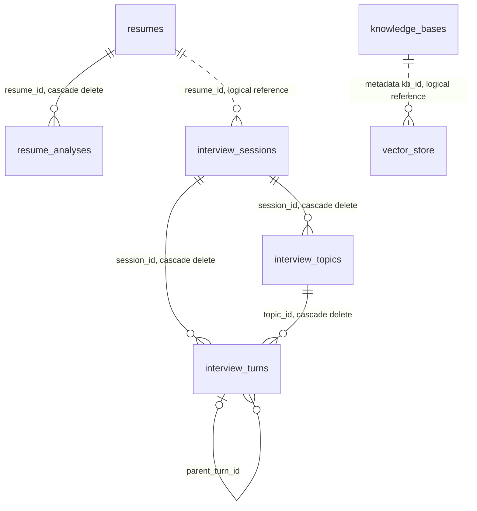

# 数据库实体与表结构

本文描述单一 Flyway 初始化脚本建立的目标结构。字段类型与约束以 `app/src/main/resources/db/migration/V1__init_schema.sql` 为准；JPA Entity 位于 `app/src/main/java/com/interview/modules/`。

## 表关系

`interview_sessions.resume_id`、`current_turn_id` 以及向量元数据中的 `kb_id` 是逻辑关联，数据库没有为它们建立外键。面试选中的知识库 ID 保存在 Session 的 JSON 字段中。

## `resumes`

简历文件元数据、解析文本和分析状态。原始文件本体存储于 MinIO。

| 字段 | 类型 | 说明 |
|---|---|---|
| `id` | `BIGSERIAL` | 主键 |
| `file_hash` | `VARCHAR(64)` | 文件 SHA-256，唯一 |
| `original_file_name` | `VARCHAR(255)` | 原文件名 |
| `file_size` | `BIGINT` | 字节数 |
| `content_type` | `VARCHAR(255)` | 检测到的文件类型 |
| `storage_key` | `VARCHAR(500)` | MinIO 对象键 |
| `storage_url` | `VARCHAR(1000)` | 对象 URL |
| `resume_text` | `TEXT` | 解析、清洗后的简历文本 |
| `upload_time` | `TIMESTAMP` | 上传时间 |
| `last_access_time` | `TIMESTAMP` | 最近访问时间 |
| `access_count` | `INTEGER` | 访问次数 |
| `analyze_status` | `VARCHAR(20)` | `PENDING / PROCESSING / COMPLETED / FAILED` |
| `analyze_error` | `VARCHAR(500)` | 最近分析错误 |

索引：`idx_resume_hash` 唯一索引。

## `resume_analyses`

每次简历分析的结果记录；一份简历可以保留多次分析历史。

| 字段 | 类型 | 说明 |
|---|---|---|
| `id` | `SERIAL` | 主键 |
| `resume_id` | `BIGINT` | 外键至 `resumes.id`，删除简历时级联删除 |
| `overall_score` | `INTEGER` | 综合评分 |
| `content_score` | `INTEGER` | 内容评分 |
| `structure_score` | `INTEGER` | 结构评分 |
| `skill_match_score` | `INTEGER` | 技能匹配评分 |
| `expression_score` | `INTEGER` | 表达评分 |
| `project_score` | `INTEGER` | 项目经验评分 |
| `summary` | `TEXT` | 总结 |
| `strengths_json` | `TEXT` | 优势 JSON 数组 |
| `suggestions_json` | `TEXT` | 建议 JSON 数组 |
| `analysis_time` | `TIMESTAMP(6)` | 分析时间 |

索引：`idx_resume_analyses_resume_id`。

## `knowledge_bases`

知识库文件元数据、来源信息和向量化状态。用户上传文件存于 MinIO；内置资料由 classpath 资源同步。

| 字段 | 类型 | 说明 |
|---|---|---|
| `id` | `BIGSERIAL` | 主键 |
| `file_hash` | `VARCHAR(64)` | 文件内容 Hash |
| `source_type` | `VARCHAR(20)` | `USER_UPLOAD / BUILT_IN` |
| `source_key` | `VARCHAR(500)` | 稳定来源键，内置资料使用 |
| `content_hash` | `VARCHAR(64)` | 来源内容版本 Hash |
| `version` | `INTEGER` | 知识内容版本 |
| `enabled` | `BOOLEAN` | 是否可检索 |
| `name` | `VARCHAR(255)` | 知识库名称 |
| `category` | `VARCHAR(100)` | 分类 |
| `original_file_name` | `VARCHAR(255)` | 原文件名 |
| `file_size` | `BIGINT` | 字节数 |
| `content_type` | `VARCHAR(255)` | 文件类型 |
| `storage_key` | `VARCHAR(500)` | MinIO 对象键；内置资料为空 |
| `storage_url` | `VARCHAR(1000)` | 对象 URL |
| `upload_time` | `TIMESTAMP` | 创建/同步时间 |
| `last_accessed_time` | `TIMESTAMP` | 最近访问时间 |
| `access_count` | `INTEGER` | 访问次数 |
| `question_count` | `INTEGER` | 提问次数统计字段 |
| `vector_status` | `VARCHAR(20)` | `PENDING / PROCESSING / COMPLETED / FAILED` |
| `vector_error` | `VARCHAR(1000)` | 向量化错误 |
| `vector_chunk_count` | `INTEGER` | 当前版本 Chunk 数 |

约束与索引：`(source_type, file_hash)` 唯一；`BUILT_IN` 来源的 `source_key` 部分唯一；另有来源类型和分类索引。原先全局 `file_hash` 唯一索引已由来源范围内的唯一索引取代。

## `vector_store`

Spring AI PgVectorStore 使用的向量表。

| 字段 | 类型 | 说明 |
|---|---|---|
| `id` | `UUID` | 主键 |
| `content` | `TEXT` | 文本 Chunk |
| `metadata` | `JSONB` | 知识库 ID、来源、版本、Chunk 序号、向量任务 ID、当前版本标记等 |
| `embedding` | `VECTOR(1024)` | Embedding 向量 |

索引：Embedding 的 HNSW/Cosine 索引、metadata GIN 索引、`metadata->>'kb_id'` 表达式索引。向量表通过 metadata 关联知识库，没有外键。

## `interview_sessions`

面试会话、异步任务状态、当前进度和完整评估报告。

| 字段 | 类型 | 说明 |
|---|---|---|
| `id` | `BIGSERIAL` | 主键 |
| `session_id` | `VARCHAR(36)` | 对外会话 ID，唯一 |
| `resume_id` | `BIGINT` | 关联简历的逻辑 ID，无外键 |
| `skill_id` | `VARCHAR(100)` | Skill 标识 |
| `difficulty` | `VARCHAR(30)` | 难度 |
| `topic_count` | `INTEGER` | Topic 数 |
| `max_follow_ups_per_topic` | `INTEGER` | 每个 Topic 的追问上限 |
| `max_turns` | `INTEGER` | Turn 上限 |
| `current_topic_order` | `INTEGER` | 当前 Topic 序号，从 0 开始 |
| `current_turn_id` | `BIGINT` | 当前 Turn 逻辑 ID，无外键 |
| `total_turns` | `INTEGER` | 已创建 Turn 数 |
| `knowledge_base_ids_json` | `TEXT` | 本次面试选中的知识库 ID 数组 |
| `status` | `VARCHAR(30)` | `CREATED / IN_PROGRESS / COMPLETED / ABORTED` |
| `status_reason` | `VARCHAR(1000)` | 会话终止原因 |
| `generation_status` | `VARCHAR(30)` | 生成任务状态 |
| `generation_error` | `VARCHAR(1000)` | 生成任务错误 |
| `evaluate_status` | `VARCHAR(30)` | 评估任务状态 |
| `evaluate_error` | `VARCHAR(1000)` | 评估任务错误 |
| `overall_score` | `INTEGER` | 综合评分，可空，范围 0–100 |
| `evaluation_report` | `TEXT` | 完整评估 JSON |
| `evaluated_at` | `TIMESTAMP` | 评估完成时间 |
| `created_at` | `TIMESTAMP` | 创建时间 |
| `updated_at` | `TIMESTAMP` | 更新时间 |
| `started_at` | `TIMESTAMP` | 进入答题时间 |
| `completed_at` | `TIMESTAMP` | 面试结束时间 |
| `version` | `BIGINT` | JPA 乐观锁版本 |

任务状态使用 `PENDING / PROCESSING / COMPLETED / FAILED`。约束：`session_id` 唯一；`status` 只允许四种 Session 状态；`overall_score` 为空或在 0–100 范围。索引：`overall_score`。

`evaluation_report` JSON 结构包含 `overallScore`、`overallFeedback`、`strengths`、`improvements`、`topicScores` 和 `turnEvaluations`。综合分数同时存于独立列，供列表与统计使用。

## `interview_topics`

面试知识点、每个知识点的追问控制、评分依据以及出题时的 Evidence 快照。

| 字段 | 类型 | 说明 |
|---|---|---|
| `id` | `BIGSERIAL` | 主键 |
| `session_id` | `BIGINT` | 外键至 `interview_sessions.id`，级联删除 |
| `category` | `VARCHAR(100)` | Topic 分类 |
| `topic_name` | `VARCHAR(255)` | Topic 名称 |
| `topic_order` | `INTEGER` | 顺序，从 0 开始 |
| `objective` | `TEXT` | 考察目标 |
| `retrieval_query` | `TEXT` | 出题时检索问题 |
| `base_question` | `TEXT` | 主问题 |
| `fallback_follow_up` | `TEXT` | 备用追问 |
| `reference_answer` | `TEXT` | 参考答案 |
| `scoring_points_json` | `TEXT` | 评分点 JSON 数组 |
| `evidence_snapshot_json` | `TEXT` | 出题时检索片段快照 JSON 数组 |
| `follow_up_count` | `INTEGER` | 已使用追问数 |
| `max_follow_ups` | `INTEGER` | 追问上限 |
| `status` | `VARCHAR(20)` | `PENDING / ACTIVE / COMPLETED` |
| `created_at` | `TIMESTAMP` | 创建时间 |
| `updated_at` | `TIMESTAMP` | 更新时间 |
| `version` | `BIGINT` | 乐观锁版本 |

约束与索引：`(session_id, topic_order)` 唯一；`topic_order >= 0`；索引 `(session_id, status)`。

## `interview_turns`

每轮主问题或追问、用户回答、决策结果和请求幂等键。

| 字段 | 类型 | 说明 |
|---|---|---|
| `id` | `BIGSERIAL` | 主键 |
| `topic_id` | `BIGINT` | 外键至 `interview_topics.id`，级联删除 |
| `session_id` | `BIGINT` | 外键至 `interview_sessions.id`，级联删除 |
| `turn_order` | `INTEGER` | 会话内顺序，从 0 开始 |
| `question` | `TEXT` | 本轮问题 |
| `answer` | `TEXT` | 用户回答，可空 |
| `turn_type` | `VARCHAR(30)` | `BASE / FOLLOW_UP` |
| `parent_turn_id` | `BIGINT` | 父 Turn 外键；删除父 Turn 时设为 NULL |
| `decision` | `TEXT` | LLM 决策 JSON |
| `request_id` | `VARCHAR(100)` | 答案提交幂等键 |
| `status` | `VARCHAR(20)` | `CREATED / ANSWER_PENDING / DECIDING / DECIDED` |
| `answered_at` | `TIMESTAMP` | 回答保存时间 |
| `created_at` | `TIMESTAMP` | 创建时间 |
| `updated_at` | `TIMESTAMP` | 更新时间 |
| `version` | `BIGINT` | 乐观锁版本 |

约束与索引：`(session_id, turn_order)` 唯一；`(session_id, request_id)` 唯一；`turn_order >= 0`；进入 `DECIDING / DECIDED` 必须已有答案；索引 `(session_id, status)`。

## JSON 与非关系存储

- 面试选择的知识库 ID 保存在 `interview_sessions.knowledge_base_ids_json`。
- Evidence 快照保存在 `interview_topics.evidence_snapshot_json`。当前结构不再建立独立的 `interview_topic_evidence` 表。
- 评估完整报告保存在 `interview_sessions.evaluation_report`。
- Redis 会话缓存是可重建热缓存，不是数据库实体表；Redis Stream 保存异步任务消息。
- 简历/知识库原始文件保存在 MinIO；pgvector Chunk 的正文、metadata 和向量保存在 `vector_store`。

## 迁移记录

| 迁移 | 内容 |
|---|---|
| `V1__init_schema.sql` | 创建全部最终业务表、pgvector、索引、外键和检查约束 |

应用启动时 Hibernate 使用 `ddl-auto: validate`，数据库结构由 Flyway 管理。合并脚本面向空数据库；已有数据库的 `flyway_schema_history` 仍记录旧版本，必须先重建数据库或按 Flyway 基线迁移策略处理，再使用合并脚本启动应用。仅删除旧迁移文件不会自动清理数据库历史。
